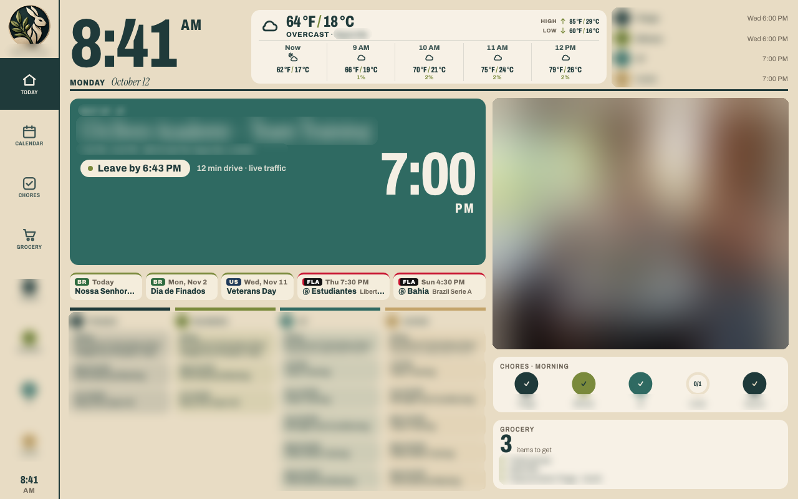
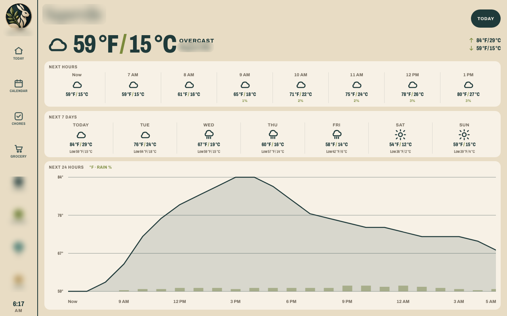

# Coelho de Oliveira dashboard — current docs (v0.1 → v0.3.2, 2026-10-12)


## Changelog
- **v0.1** — First dashboard on the frame: iCloud calendar, Open-Meteo weather, chores, grocery, night mode, kiosk APK.
- **v0.2** — One-line °F/°C, full-width Home weather header (table layout), 7-day weather page,
  continuous header divider, Reminders grocery, photo slideshow + idle screensaver,
  iCloud public album sync, holidays & Flamengo strip.
- **v0.3** — "Leave by" pill on Next up (`/api/eta`, Nominatim + OSRM).
- **v0.3.1** — TomTom live traffic as the primary ETA source.
- **v0.3.2** — Slideshow robustness (random start, own timer, load timeout, watchdog).
- **v0.4** — Grocery store tagger for the shared Reminders list.
- **v0.4.1** — Tagger reliability: run log, status counters, stale warning + notification.
- **v0.4.2** — Hide store tags on the dashboard; Quick add from real list history.
- **v0.5** — Photo date/place captions on the Home slideshow and screensaver.
- **v0.5.1** — Next Up shows the event date (time line + label above the big time).




What changed in the home dashboard that runs on the PF1007L frame (Android 6.0.1,
old system WebView), and how to run, configure and reload it. The server runs on a
Mac that stays on at home; the frame loads `http://DASHBOARD_HOST:4173` over Wi‑Fi.

## Changes in v0.2

### Weather
- **One-line temperatures** everywhere in the weather UI: `59 °F / 15 °C` (no stacked °F/°C lines).
- **Home weather header uses the full card width**: current conditions on the left
  (icon, big `°F / °C`, condition · place), today's High/Low on the right, and the next
  5 hours evenly spread underneath. Every hour label has full AM/PM (`2 PM`).
- The header is built with **`display: table` / `table-cell` and fixed percentages**
  (20 % per hour), because the frame's old WebView mis-handled CSS grid `fr` columns
  and flex `gap` (hourly temperatures ran together and the content only filled ~60 %).
- **Weather page shows 7 days** (Open-Meteo `forecast_days=7`), each with
  `High °F / °C` and `Low °F / °C`.
- **One continuous divider** under the clock, weather card and family list
  (a single `::before` rule spanning the whole header row).

### Grocery list from Reminders
- The grocery card mirrors a shared Reminders list (`REMINDERS_GROCERY_LIST`) via a
  Swift EventKit helper (`npm run reminders:build`) with an osascript fallback.
- macOS requires a one-time **Reminders permission for `node`**:
  System Settings → Privacy & Security → Reminders → enable `node`
  (or click *Allow* on the prompt). Without it the list is empty.

### Photo slideshow and idle screensaver
- The big panel on Home is a **crossfading slideshow** (15 s per photo, 1.2 s fade,
  next image preloaded). Falls back to the family emblem when there are no photos.
- **Screensaver**: after 5 min without a touch, photos go full-screen with a small
  clock, date and `°F / °C` weather overlay. Tap to dismiss (returns to Home).
  It never opens during night mode and closes if night starts.
- Photos come from `PHOTOS_DIR`. The server re-encodes each one to a JPEG that fits
  **1280×800** (macOS `sips`) and caches it in `~/Library/Caches/coelho-photos`,
  which keeps memory use low on the 1 GB frame.
- **iCloud shared album sync**: if `ALBUM_URL` points to a shared album with
  *Public Website* enabled, the server syncs it every **30 minutes** (and at start):
  new photos are downloaded as `icloud-<hash>.jpg`, photos removed from the album are
  deleted. Only `icloud-*` files are managed; other files in the folder are left alone.
  It uses the same anonymous CloudKit calls as the iCloud web viewer
  (`records/resolve` on the public DB → `anonymousPublicAccess` token →
  `records/query` on the shared zone → `resJPEGMedRes.downloadURL`).
  An invite-only album (no Public Website) cannot be read without an Apple ID sign-in.

### Holidays & game days strip
- A compact row between *Next up* and the family columns: the next **3 public holidays**
  (US + Brazil, tagged `US` / `BR`, Brazilian ones in Portuguese) and Flamengo's next
  **2 matches** (`FLA` tag, `@` away / `vs` home, competition). Kick-off times are
  converted to America/Chicago with full AM/PM (`Thu 7:30 PM`).
- Sources (free, no keys): [date.nager.at](https://date.nager.at) `NextPublicHolidays/US|BR`
  (cached 24 h; only nationwide holidays) and ESPN's public JSON
  `site.api.espn.com/apis/site/v2/sports/soccer/all/teams/819/schedule?fixture=true`
  (Flamengo = ESPN team 819, all competitions; cached 3 h; last good data is served
  if a source fails).

## API

| Endpoint | What |
|---|---|
| `GET /api/weather` | Open-Meteo current, hourly, 7-day |
| `GET /api/calendar` | iCloud CalDAV events |
| `GET /api/grocery` / `/api/groceries` | Reminders grocery list |
| `GET /api/photos` | Photo list (`source: folder` or `emblem`) |
| `GET /api/photos/<id>` | Photo as resized JPEG (≤ 1280×800) |
| `GET /api/photos/sync` / `POST` | Album sync status / run a sync now |
| `GET /api/extras` | Next holidays + Flamengo fixtures |

## Refresh intervals
- Clock: every second. Grocery/chores lists: every **20 s**.
- Calendar, weather, photos, extras: every **5 min** (server caches upstream data).
- Album sync: every 30 min. The frame only needs Wi‑Fi; USB is just power.

## URL parameters (testing / screenshots)
- `?night=off` — disable night mode. `?now=2026-10-12T14:00:00-05:00` — fake the time.
- `?saver=5` — open the screensaver after 5 s idle instead of 300.
- `#home`, `#weather`, `#calendar`, … — open a view directly.

## Old-WebView CSS rules
The frame's WebView is old. In new UI code:
- Avoid flex/grid `gap`, `aspect-ratio`, `object-fit`; use margins/padding,
  `display: table` with percentage widths, and `background-size: cover` on divs.
- Add `-webkit-` prefixes for flex and transitions; keep text `white-space: nowrap`
  with ellipsis where space is tight.
- Preload at most one image ahead; serve images already resized.

## Configuration (`dashboard/.env`, never committed)
```
PORT=4173
LAT=00.0000
LON=-00.0000
WEATHER_PLACE=Your Town
ICLOUD_USER=you@example.com
ICLOUD_CALENDAR_NAME=Family
ICLOUD_APP_PASSWORD=xxxx-xxxx-xxxx-xxxx
REMINDERS_GROCERY_LIST=Groceries
NIGHT_START=23:00
NIGHT_END=06:00
PHOTOS_DIR=~/dashboard-photos
ALBUM_URL=https://photos.icloud.com/shared/album/<album-key>
HOME_ADDRESS=123 Main St, Your Town, ST 00000
HOME_LAT=00.0000
HOME_LON=-00.0000
TOMTOM_API_KEY=your-tomtom-key
```
`ALBUM_URL` gives read access to the album to anyone who has it — keep it only in `.env`.
The kiosk APK reads its URL from the git-ignored `dashboard/kiosk/local.properties`
(`dashboard.url=http://DASHBOARD_HOST:4173`).

## Deploy and reload
```
cd dashboard
npx vite build                                   # static changes: live on next frame reload
launchctl kickstart -k gui/$(id -u)/com.coelho.dashboard   # server changes
```
Reload the frame: power-cycle it, or over adb:
`adb shell am force-stop com.wesbos.homehq; adb shell monkey -p com.wesbos.homehq -c android.intent.category.LAUNCHER 1`.

## v0.3 — "Leave by" on Next up
- For a timed event with a location, Next up shows a pill: **Leave by H:MM AM/PM**
  (event start − driving time − 5 min buffer), then **Leave in N min** (amber at ≤ 15 min),
  **LEAVE NOW** (pulsing, until there is no buffer left) and **Running late · N min**,
  plus the drive time (`11 min drive`).
- `GET /api/eta?to=<event location>` → `{ ok, minutes, km, source }`, cached 10 min per destination.
- Geocoding: OpenStreetMap Nominatim (≤ 1 req/s, cached). Multi-line locations
  ("Place\nStreet, City") are retried line by line.
- Routing (v0.3, superseded by TomTom below): Waze live-map (`/live-map/api/user-drive`) is tried first for live traffic, but it
  currently answers 403 to server requests (the old `RoutingManager/routingRequest` returns 410),
  so in practice the OSRM demo server is used (free, **no live traffic**). The UI only adds
  "live traffic" when the Waze source answered.
- Home location comes from `HOME_LAT` / `HOME_LON` (or `HOME_ADDRESS`) in `.env` — never committed.
  Upstream (wesbos) uses a static `travel` minutes field on mock events (`App.leaveBy` in
  `dashboard/js/app.js`, pill in `dashboard/js/views/home.js`); there is no routing API there.

### v0.3.1 — TomTom live traffic
- `/api/eta` now uses the **TomTom Routing API** first
  (`routing/1/calculateRoute/<from>:<to>/json?traffic=true&departAt=now&travelMode=car`),
  falling back to OSRM. The pill adds "· live traffic" only when TomTom answered;
  the response also carries `delayMin` (traffic delay).
- Geocoding stays on Nominatim (cached); TomTom Search geocode is a fallback.
- Request volume: only the Next up event is looked up; cached 10 min within 3 h of the
  start and 60 min further out (≈ a few hundred requests/day max, well under the free tier).
- Key lives only in `.env`: `TOMTOM_API_KEY=your-tomtom-key`.


## v0.3.2 — Slideshow robustness
The Home panel could appear stuck on one photo on the frame. `dashboard/js/slides.js` now:
- starts at a **random photo** (a reload no longer always shows the same first image);
- owns a **self-rescheduling timer** (15 s after each photo appears) that re-renders and the
  20 s / 5 min data refreshes cannot reset;
- advances even when an image load hangs or fails (**8 s load timeout**);
- has a **watchdog** that restarts rotation if nothing changed for 3 intervals;
- rebinds to the panel if the Home view is ever rebuilt.

## Leave-by states (summary)
| State | When |
|---|---|
| Leave by H:MM AM/PM | more than 60 min before leave time |
| Leave in N min | ≤ 60 min (amber at ≤ 15) |
| LEAVE NOW (pulsing) | leave time passed, still within the 5-min buffer |
| Running late · N min | arriving after the start even if leaving now |

Leave time = event start − drive time (TomTom live traffic, OSRM fallback) − 5 min.
Shown only for upcoming timed events with a location.

## Sharing publicly
- Screenshots for public posts are taken from the real dashboard and then **redacted**:
  family names and avatars, event titles and addresses, grocery items, the place name and
  all personal photos are blurred. Only generic UI, weather numbers, holidays and public
  match fixtures stay legible.
- Check every image before posting; never publish raw screenshots, `.env` values, the
  album link, home address/coordinates or network details.
- Public posts credit the upstream project:
  [wesbos/photo-frame-dashboard](https://github.com/wesbos/photo-frame-dashboard).

## Open items
- [x] **Stable address for the dashboard host** (done 2026-10-12): DASHBOARD_HOST has a DHCP
  reservation on the home gateway; macOS private Wi-Fi address set to Fixed. This prevents
  address changes only, not sleep/Wi-Fi outages/stopped service.
- [x] Verify the v0.3.2 slideshow rotation on the frame itself — verified Oct 13, 2026 after a power-cycle.

## v0.4 — Grocery store tagger
- Every **5 minutes** (inside the dashboard server, `server/tagger.js`) each **incomplete** item in the
  grocery Reminders list gets ONE notes line `stores: #tag1 #tag2` (lowercase, space-separated).
- It never changes the title, completion, due date or any other notes line. Writes go through the
  EventKit helper (`server/reminders.swift`, new `setnotes` command, notes only, refuses completed items),
  so it uses the Reminders permission already granted to `node`.
- **Hand edits win:** the last line the tagger wrote is kept per reminder id in
  `~/Library/Application Support/coelho-tagger/state.json`. If the current `stores:` line differs from it
  (or exists without a record), it is treated as hand-edited and never overwritten.
- Rules: `server/tagger-map.json` (keywords in Portuguese and English, accent-insensitive, first match
  wins; unmatched items stay untagged). Allowed tags: `#costco #target #marianos #jewel #traderjoes
  #intlfresh` (International Fresh Market) `#napervillefresh` (Naperville Fresh Market) `#walmart
  #dollartree #wholefoods #dicks` (Dick's Sporting Goods) `#hmart #any` (nearly every grocery store).
- Status: `GET /api/grocery/tagger`. Disable with `GROCERY_TAGGER=off` in `.env`.
  Tests: `node --test server/tagger.test.js`.

## v0.4.1 — Tagger reliability
- Runs inside the dashboard server (LaunchAgent `com.coelho.dashboard`, `RunAtLoad=true`,
  `KeepAlive=true`): it starts at login (the host logs in automatically after a reboot) and is
  restarted by launchd if it crashes. A run starts at server start and then every 5 min; runs never
  overlap, and every run catches its own errors so one failure never stops the interval.
- Log: `~/Library/Logs/coelho-tagger.log`, one line per run
  (`<time> ok checked=N changed=N skipped=N` or `<time> error failures=N <message>`), trimmed to the
  newest half when it passes ~1 MB.
- `GET /api/grocery/tagger` → `lastSuccess`, `lastError`, `lastErrorAt`, `consecutiveFailures`,
  `checked`, `changed`, `applied`, `skipped`, `stale`, `intervalMinutes`.
- **Failure flag:** `stale` is true after 3 consecutive failures or when the last success is older
  than 30 min. The Home Grocery card then shows a small "Store tags not updating since H:MM PM" pill,
  and the Mac posts one notification (and another when it recovers).
- The failure path is covered by a unit test with a simulated error (`node --test server/tagger.test.js`).
- Store tags are never shown on the dashboard: `/api/grocery` strips every `stores:` line from notes server-side (other notes lines are kept). The stale warning pill is still shown.

## v0.4.2 — Quick add from real history
- The Grocery page "Quick add" tiles come from the grocery Reminders list itself (no presets):
  items **completed** in the last 90 days (EventKit `history` command in the helper), deduped
  case/accent-insensitively, ranked by frequency then most recent, excluding items open right now;
  up to 12. When the 90-day window has fewer than 12, it is filled from the last 365 days.
  Cached 10 min; returned as `usuals` by `/api/grocery` (never with store tags).
- Tapping a tile adds a new incomplete reminder with that title (existing `add` path), which the
  tagger then tags.


## v0.5 — Photo date & place captions

Each slideshow photo (Home panel and idle screensaver) shows a small cream caption in its
lower-right corner on a soft dark gradient, e.g. `July 4, 2025 · Naperville, IL`.

- **Date:** EXIF `DateTimeOriginal` (fallback `DateTimeDigitized` / `DateTime`), read directly
  from the JPEG bytes by `server/photometa.js` (no extra tools). Shown as camera-local date.
- **Place:** EXIF GPS (iCloud shared-album downloads keep it), reverse-geocoded with
  OpenStreetMap Nominatim (`zoom=10`, ≤ 1 request/s, identifying User-Agent). Short form:
  `City, ST` in the US, `City, CC` elsewhere. Cached permanently by coordinates rounded to
  2 decimals, so each area is looked up once.
- **Caches (outside the repo, never committed):** per-photo metadata in
  `~/Library/Caches/coelho-photos/meta.json`; place names in
  `~/Library/Application Support/coelho-dashboard/places.json`.
- `/api/photos` items gain optional `date` and `place`. Place is omitted when unknown; the
  caption is omitted entirely when neither is known.
- Old-WebView safe: absolute positioning, `-webkit-linear-gradient`, `text-shadow`, no `gap`.
  The caption lives inside each crossfade layer, so it fades with its photo.

## v0.5.1 — Next Up event date

The Next Up time line now starts with the day: `Today` / `Tomorrow` / `Wed, Oct 14`, then
`4:30 PM – 6:00 PM · location`. A small uppercase label (`TODAY`, `TOMORROW`, `WED OCT 14`)
sits above the big start time so it is never ambiguous. Dates use America/Chicago; times keep
full AM/PM. Plain block/flex layout with `-webkit-` prefixes (old-WebView safe).

- v0.5.2: place captions say `UK` instead of `GB`, and London boroughs/districts (City of Westminster, Greater London, etc.) display as `London, UK`. Applied at display time; the place cache keeps raw names.

## v0.7 (branch `cursor/home-layout-v2`, preview `?layout=v2`) — Home v3, themes, month view

Local commits only; not pushed or merged yet.

**Home v3 layout** (`js/views/home3.js`, `css/views/home3.css`)
- Header: clock · compact weather · family 2×2.
- Weather card, inspired by a phone widget: big `70 °F / 21 °C`, condition in italic, then
  `H … · L … · Feels …` (Open-Meteo `apparent_temperature`) and 5 small hourly bars (bar height =
  relative temperature, AM/PM labels).
- Family 2×2: avatar + name + Find My place + "Updated X min ago". It reads `/api/whereabouts`,
  which serves `~/Library/Application Support/coelho-dashboard/whereabouts.json` (or
  `WHEREABOUTS_FILE`). Shape: `{ "updatedAt": ISO, "people": { "thiago": { "place": "Home", "at": ISO }, … } }`.
  Without that file it shows "Location off · Find My not connected".
- Family calendar: one table, Today + next 4 days, 4 equal slots per day, "+N more" opens
  Calendar.
- Photo: fixed 3:2 landscape box (padding-top ratio, no `aspect-ratio`), whole photo (contain) on
  a blurred fill.
- Chores: progress rings per person in their color, "Anyone" grey, tagged **Preview**. Counts come
  from the existing chores store for the current routine; tapping still opens the Chores page.
- Grocery: count + up to 6 items in two columns.

**Event color rule** (`family.js` `assignEvent`)
- The calendar is the Apple family calendar `Calendário da Família`, read over iCloud CalDAV.
- An event belongs to a person when its title begins with that person's name before " — "
  (e.g. "⚽️ JP — Team Training").
- Anything else (no prefix, school-wide, trips, shows) counts as Family / everyone (dark teal).
- The chip color is the person's avatar color.
- The calendar fetch now starts on the 1st of the current month and covers 75 days, so the month
  view is full.

**Calendar page**
- Agenda / Week / **Month** toggle. Month is a Sunday-first table with equal cells, 2–3 chips per
  day and "+N more"; the arrows move to next month. `?cal=month` opens it directly.
- A color legend at the bottom: each person, Family / everyone, Holiday BR, Holiday US, Flamengo.

**Theme** (Settings → Theme: Light / Dark / Auto (sunset))
- Dark keeps the palette (forest/teal paper, cream ink, olive accents) via `css/theme-dark.css`
  (`html.theme-dark`).
- Auto uses today's Open-Meteo sunset and sunrise and is re-checked every minute.
- Saved per frame in `localStorage`. `?theme=dark|light|auto` overrides it for screenshots.

**Find My (family locations): status**
- The dashboard Mac is signed into a different Apple ID than Thiago's.
- The Find My cache (`~/Library/Caches/com.apple.findmy.fmipcore`) is blocked by macOS privacy
  controls ("Operation not permitted"). On macOS 14.4+ the `Items.data` / `Devices.data` files
  are also encrypted with a keychain key, so reading the cache is not a viable path.
- The iCloud credential in `.env` is an app-specific password (CalDAV only). It cannot access Find
  My.
- Workable options, all producing the same `whereabouts.json`:
  1. **Recommended:** Thiago (the Family Sharing organizer) runs `pyicloud` once on the MacBook
     with his own Apple ID, completes 2FA interactively and stores the session in the keychain.
     A LaunchAgent then polls the family devices list every ~5 min and reverse-geocodes each
     member's primary iPhone to "Home" (within ~150 m of HOME_LAT/LON) or a city or neighborhood.
     The session must be re-trusted every ~2 months. This uses an unofficial API that can break.
  2. Each person's iPhone runs a Shortcuts automation (e.g. when leaving or arriving home) that
     POSTs a place to the dashboard. This is official and private, but needs per-phone setup.
  3. Share each person's location with the Mac's Apple ID and read the Find My app window. This
     is fragile and not recommended.
